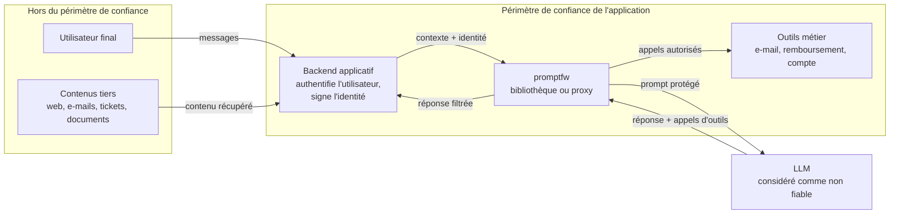

# Modèle de menace

Ce document précise ce que `promptfw` protège, contre qui, sous quelles hypothèses, et ce qui reste hors de portée. Il sert de référence pour juger si un contrôle est suffisant, et pour interpréter les résultats de l'[évaluation](EVALUATION.md).

## 1. Système étudié

`promptfw` s'insère entre une application et un grand modèle de langage (LLM), sous forme de bibliothèque Python ou de proxy compatible avec l'API Chat Completions d'OpenAI. L'application peut fournir au modèle des contenus externes (documents RAG, e-mails, tickets, résultats d'outils) et lui permettre de déclencher des actions par appel d'outils (*function calling*).

Le LLM est volontairement placé **hors** du périmètre de confiance : le projet part du principe qu'il peut toujours être manipulé par le texte qu'il lit.

## 2. Actifs à protéger

| Actif | Exemple | Atteinte redoutée |
|---|---|---|
| Secrets présents dans le contexte | prompt système, clés, identifiants internes | Divulgation à l'utilisateur ou à un tiers (OWASP LLM02, LLM07) |
| Données des utilisateurs | historique de conversation, données personnelles | Exfiltration via une URL ou un outil |
| Actions à effet de bord | envoi d'e-mail, remboursement, modification de compte | Exécution non autorisée (OWASP LLM06) |
| Comptes utilisateurs | adresse de récupération, mot de passe | Prise de contrôle d'un compte tiers (BOLA) |
| Disponibilité du service | temps de réponse du pare-feu | Saturation par des entrées volumineuses |

## 3. Attaquants considérés

| Attaquant | Ce qu'il contrôle | Ce qu'il ne contrôle pas | Exemple |
|---|---|---|---|
| **A1. Auteur de contenu tiers** | Le texte d'un document, d'une page web, d'un e-mail ou d'un résultat d'outil que l'application fera lire au modèle | Le prompt système, la politique, l'identité de l'utilisateur | Injection indirecte dans un ticket client |
| **A2. Utilisateur final malveillant** | Ses propres messages, authentifié sous sa propre identité | L'identité d'un autre utilisateur, le backend | Demander à l'assistant de modifier le compte d'un tiers (cas Meta / Instagram, mai 2026) |
| **A3. Attaquant ayant accès réseau au proxy** | Des requêtes HTTP arbitraires vers le proxy, y compris l'en-tête d'identité | La clé de signature des identités | Se faire passer pour un autre utilisateur |

Le **modèle** n'est pas un attaquant au sens propre, mais il est traité comme un composant pouvant agir contre l'utilisateur dès qu'il a été manipulé par A1 ou A2.

## 4. Hypothèses de sécurité

Les garanties décrites plus bas ne valent que si ces hypothèses sont respectées. Chacune correspond à une responsabilité de l'intégrateur.

| # | Hypothèse | Conséquence si elle est violée |
|---|---|---|
| H1 | Le backend authentifie l'utilisateur et transmet son identité de façon fiable (jeton signé, ou proxy inaccessible aux utilisateurs) | A3 peut usurper une identité et contourner `args_bound_to_session`, les permissions et les attributs |
| H2 | La clé `PROMPTFW_PRINCIPAL_KEY` reste secrète et partagée uniquement entre le backend et le pare-feu | Les jetons peuvent être forgés |
| H3 | La politique (outils, permissions, hôtes autorisés, canaries) est correcte et maintenue | Un outil mal déclaré ou un hôte trop large ouvre un chemin d'attaque |
| H4 | En mode bibliothèque, l'application déclare la provenance réelle de chaque contenu ; en mode proxy, elle marque les contenus externes insérés dans des messages `user` | Un document piégé est traité comme un message de l'utilisateur, avec des poids de détection réduits |
| H5 | Les outils n'exécutent un appel qu'**après** le verdict de `inspect_egress` | Le contrôle des outils n'a aucun effet |
| H6 | Les API métier appelées par les outils effectuent leur propre contrôle d'autorisation | `promptfw` devient l'unique barrière, ce qui contredit la défense en profondeur |
| H7 | Le proxy tourne en une seule instance, ou dispose d'un stockage partagé pour l'anti-rejeu | Un jeton de confirmation peut être rejoué sur une autre instance |

## 5. Menaces et contrôles

| Menace | Attaquant | Contrôle | Nature | Couche |
|---|---|---|---|---|
| Instructions cachées dans un contenu tiers | A1 | Encadrement par nonce, détection de falsification | Invariant (nonce) / scoré (forme du délimiteur) | `provenance` |
| Instructions explicites ou reformulées | A1, A2 | Règles FR/EN pondérées selon la provenance | Scoré | `ingress` |
| Dissimulation (Unicode invisible, homoglyphes, base64…) | A1, A2 | Clôture bornée de lectures inverses | Signal + support des autres couches | `normalize` |
| Fuite du prompt système ou d'un secret | A1, A2 | Canary recherché dans toutes les lectures de la réponse | Invariant | `egress` |
| Exfiltration par URL ou image chargée automatiquement | A1 | Liste d'hôtes autorisés, détection des images markdown, HTML et par référence | Invariant | `egress` |
| Fuite de secrets ou de données personnelles | A1, A2 | Motifs de secrets, PII (Luhn pour les cartes) | Scoré | `egress` |
| Appel d'outil non autorisé | A1, A2 | Registre fermé, permissions par rôle, contraintes de valeurs, attributs, origines autorisées, taint, confirmation | Invariant | `toolauth` |
| Prise de contrôle du compte d'un tiers (BOLA) | A2 | `args_bound_to_session` : l'objet ciblé doit appartenir à l'utilisateur | Invariant | `toolauth` |
| Usurpation d'identité auprès du proxy | A3 | Jeton HMAC signé, expiration ≤ 300 s, usage unique | Invariant | proxy (`identity.py`) |
| Rejeu d'une confirmation pour une autre action | A2, A3 | Confirmation liée à l'outil et à l'empreinte SHA-256 des arguments, `jti` à usage unique | Invariant | proxy |
| Injection visuelle (image contenant du texte) | A1 | Contenu non textuel refusé dans les résultats d'outils (`non_text_content`) | Invariant (selon la politique) | proxy |
| Saturation par une entrée volumineuse | A1, A2 | Limites de taille vérifiées avant toute analyse | Invariant | `firewall.py` |
| Erreur interne d'une couche | n/a | Refus systématique (*fail closed*) | Invariant | `firewall.py` |
| Injection relayée par le journal d'audit | A1 | Aucun contenu attaquant journalisé, empreintes HMAC | Conception | `audit.py` |

## 6. Hors périmètre

- Un attaquant qui contrôle le prompt système, la politique, les poids du modèle, le processus du pare-feu ou la machine qui l'héberge.
- La modération de contenu (toxicité, désinformation, contenus illicites).
- La sécurité des outils eux-mêmes (une fois un appel autorisé, son exécution n'est pas confinée par `promptfw`).
- L'isolation système du processus de l'agent (conteneur, seccomp, réseau), qui relève d'une autre couche de défense.

## 7. Risques résiduels connus

Ces risques sont acceptés en l'état et documentés ; plusieurs sont mesurés dans l'[évaluation](EVALUATION.md).

| Risque | Pourquoi il subsiste | Mesure ou indice |
|---|---|---|
| Injection reformulée non détectée en entrée | La détection par motifs ne généralise pas aux paraphrases | 60,4 % de blocage sur le jeu séparé, 28 % sur les paraphrases générées |
| Fuite paraphrasée d'un secret | Le canary n'est reconnu que s'il est reproduit, éventuellement encodé | Non mesurable par le juge actuel de l'évaluation |
| Document externe non marqué en mode proxy | Le protocole ne transporte pas la provenance | Avertissement au démarrage du proxy |
| Payload relayé par une réponse antérieure de l'assistant | Par défaut, l'assistant est relu comme `USER` | Bloqué seulement avec `assistant_after_data: data` |
| Domaine autorisé mutualisé | La correspondance par suffixe autorise tous les sous-domaines | Responsabilité de configuration (H3) |
| Rejeu entre plusieurs instances du proxy | Cache anti-rejeu en mémoire | Hypothèse H7 |
| Secret partagé HMAC | Le backend et le pare-feu détiennent la même clé | Une signature asymétrique éviterait ce partage |
| Contenu non textuel accepté dans les messages `user` | Choix par défaut `block_untrusted` | Configurable avec `non_text_content: block` |
